<!-- Sahil Sonawane | GitHub Profile -->
<div align="center">

  <!-- ==================== HERO BANNER ==================== -->
  <a href="https://sahilsonawane-portfolio.vercel.app/">
    
  </a>

  <br/><br/>

  <!-- ==================== CONNECT BADGES ==================== -->
  <p align="center">
    <a href="https://github.com/SahilSonawane2605">
      
    </a>
    &nbsp;
    <a href="https://www.linkedin.com/in/sahil-sonawane-bb075139a">
      
    </a>
    &nbsp;
    <a href="mailto:sahil.sonawane.26005@gmail.com">
      
    </a>
    &nbsp;
    <a href="https://sahilsonawane-portfolio.vercel.app/">
      
    </a>
    &nbsp;
    <a href="https://www.instagram.com/sahil_s.py/">
      
    </a>
  </p>

</div>

<br/>

<!-- ==================== 01 / ABOUT ==================== -->



<br/>

### 🧠 Profile &amp; Core Philosophy

I am a **Third-year Computer Engineering student** at **KJEI's Trinity College of Engineering and Research, Pune (Class of 2028)**, exploring and building intelligent software systems with a primary technical focus on **Artificial Intelligence (AI), Machine Learning (ML), Generative AI (GenAI), and Agentic AI**.

My engineering focus centers on:
- **Machine Learning &amp; Prediction Systems:** Practical implementation of predictive models, tabular and spatial data processing, and rigorous model evaluation in Python.
- **Generative AI &amp; LLMs:** Experimenting with Large Language Models, prompt engineering, structured output extraction, Google Gemini API integrations, and retrieval-augmented generation (RAG) concepts.
- **Agentic AI &amp; Memory Architectures:** Designing multi-step agent workflows, tool-using agents, and stateful memory retrieval systems — explored through my research prototype **MnemOS / Agentic Learning Digital Twins**.
- **AI Application Engineering &amp; Supporting Systems:** Leveraging robust backend APIs (**FastAPI, Flask, SQLite**) as critical infrastructure to deploy, test, and serve AI applications. Web interfaces (**React, Vite, Tailwind CSS**), computer vision (**OpenCV**), version control (**Git, GitHub**), and geospatial analysis (**Leaflet, Shapely**) serve as supporting technical capabilities.

<br/><br/>

<!-- ==================== 02 / RECOGNITION ==================== -->



<br/><br/>

<!-- ==================== 03 / SELECTED WORK ==================== -->


<!-- 01: MnemOS (Flagship AI & Agentic Prototype) -->
<a href="https://github.com/SahilSonawane2605">
  
</a>

<!-- 02: SURAKSHA-SETU (Deterministic GIS Platform - Supporting) -->
<a href="https://github.com/SahilSonawane2605">
  
</a>

<!-- 03: ECO-ROUTE (Environmental Intelligence Prototype - Supporting) -->
<a href="https://github.com/SahilSonawane2605">
  
</a>

<!-- 04: Anti-Sleep Alarm for Drivers (Embedded Safety - Supporting) -->
<a href="https://github.com/SahilSonawane2605">
  
</a>

<br/><br/>

<!-- ==================== 04 / TOOLKIT ==================== -->


<br/>

### 🛠️ Technical Competencies &amp; Hierarchy

```yaml
01_AI_and_Machine_Learning:
  primary_language: Python
  core_concepts: [Machine Learning, Data Processing, Feature Engineering, Model Evaluation]
  focus: Predictive modeling & data-driven problem solving

02_Generative_AI:
  models_and_apis: [Google Gemini API, Large Language Models (LLMs)]
  techniques: [Prompt Engineering, Structured Output Generation, RAG Retrieval Concepts]
  implementation: Context-aware query pipelines & educational synthesis

03_Agentic_AI_and_Memory:
  architecture: [AI Agents, Tool Calling Workflows, Task Orchestration]
  research_direction: "Agentic Learning Digital Twins — Intelligent Personalized Learning Framework"
  memory_systems: [Contextual Memory Capture, Structured Storage, Retrieval Workflows]

04_AI_Application_Engineering:
  backend_frameworks: [FastAPI, Flask, Node.js, Express.js]
  data_persistence: [SQLite, MySQL, MongoDB, Firebase Firestore]
  protocols: [REST APIs, Asynchronous Endpoints, Clean System Boundaries]

05_Supporting_Capabilities:
  frontend_interfaces: [React, Vite, Tailwind CSS, JavaScript, HTML5, CSS3]
  computer_vision_and_hardware: [OpenCV, Arduino Microcontroller, IR Sensor Interfacing]
  geospatial_tools: [Leaflet, OpenStreetMap, Shapely]
  workflow_and_tools: [Git, GitHub, Postman, Linux CLI]
```

<br/><br/>

<!-- ==================== 05 / COMMIT LOG ==================== -->

<div align="center">
  
  <br/><br/>
  
</div>

<br/><br/>

<!-- ==================== 06 / MILESTONES & CERTIFICATIONS ==================== -->


<br/><br/>

<!-- ==================== 07 / CONNECT ==================== -->

<div align="center">
  <p align="center">
    <a href="mailto:sahil.sonawane.26005@gmail.com">
      
    </a>
    &nbsp;
    <a href="https://www.linkedin.com/in/sahil-sonawane-bb075139a">
      
    </a>
    &nbsp;
    <a href="https://sahilsonawane-portfolio.vercel.app/">
      
    </a>
  </p>

  <br/>

  <!-- Footer Signature & Motto -->
  
</div>
