<!-- Sahil Sonawane | GitHub Profile -->
<div align="center">

  <!-- ==================== HERO BANNER ==================== -->
  <a href="https://sahilsonawane-portfolio.vercel.app/">
    
  </a>

  <br/><br/>

  <!-- ==================== CONNECT BADGES ==================== -->
  <p align="center">
    <a href="https://github.com/SahilSonawane2605">
      
    </a>
    &nbsp;
    <a href="https://www.linkedin.com/in/sahil-sonawane-bb075139a">
      
    </a>
    &nbsp;
    <a href="mailto:sahil.sonawane.26005@gmail.com">
      
    </a>
    &nbsp;
    <a href="https://sahilsonawane-portfolio.vercel.app/">
      
    </a>
    &nbsp;
    <a href="https://www.instagram.com/sahil_s.py/">
      
    </a>
  </p>

  <br/>

  <!-- ==================== LIVE TERMINAL SYSTEM.INFO ==================== -->
  <picture>
    <source media="(prefers-color-scheme: dark)" srcset="dark.svg">
    <source media="(prefers-color-scheme: light)" srcset="light.svg">
    
  </picture>

</div>

<br/>

<!-- ==================== 01 / ABOUT ==================== -->


<br/><br/>

<!-- ==================== 02 / RECOGNITION ==================== -->


<br/><br/>

<!-- ==================== 03 / SELECTED WORK ==================== -->


<!-- SURAKSHA-SETU -->
<a href="https://github.com/SahilSonawane2605">
  
</a>

<!-- ECO-ROUTE -->
<a href="https://github.com/SahilSonawane2605">
  
</a>

<!-- MnemOS -->
<a href="https://github.com/SahilSonawane2605">
  
</a>

<!-- Anti-Sleep Alarm for Drivers -->
<a href="https://github.com/SahilSonawane2605">
  
</a>

<br/><br/>

<!-- ==================== 04 / TOOLKIT ==================== -->


<br/><br/>

<!-- ==================== 05 / COMMIT LOG ==================== -->


<div align="center">
  
  <br/><br/>
  
</div>

<br/><br/>

<!-- ==================== 06 / MILESTONES ==================== -->


<br/><br/>

<!-- ==================== 07 / CONNECT ==================== -->


<a href="mailto:sahil.sonawane.26005@gmail.com">
  
</a>

<br/>

<div align="center">

```python
class SahilSonawane:
    def __init__(self):
        self.role = "Third-year Computer Engineering Student"
        self.college = "Trinity College of Engineering and Research, Pune"
        self.graduation = 2028
        self.interests = ["AI/ML", "Generative AI", "LLMs", "Backend Engineering", "GIS"]
        self.motto = "Engineering ideas into useful projects."

    def get_status(self):
        return "Building • Learning • Shipping"
```

<sub>Crafted with custom technical SVG animations, cyan-violet architecture &amp; deterministic design.</sub>

</div>
