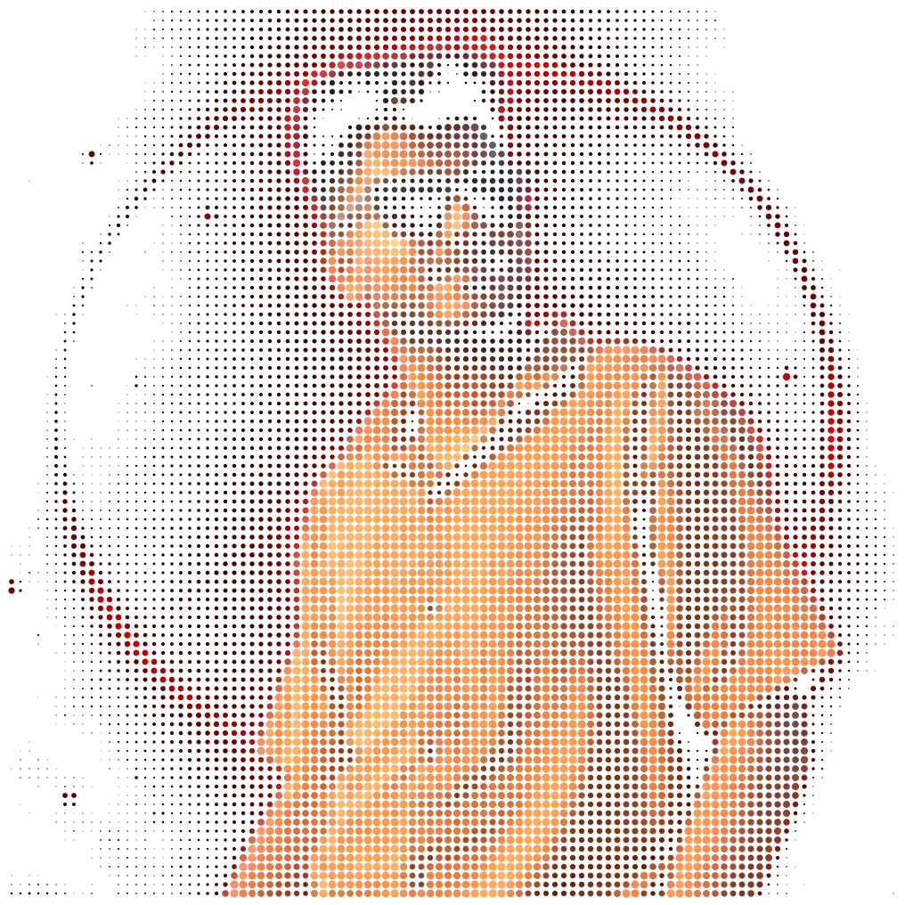
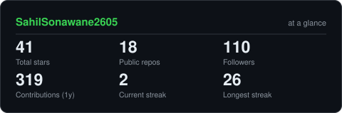
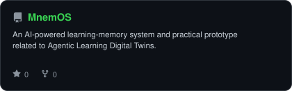

<div align="center">

<!-- PORTRAIT - generated by scripts/dotify.py from assets/jacket.png. -->


<br>

<!-- NAME / TAGLINE - animated typing -->
<a href="https://github.com/SahilSonawane2605">
  
</a>

<br>

<!-- SOCIALS -->
<a href="https://www.linkedin.com/in/sahil-sonawane-bb075139a/"></a>
<a href="https://www.instagram.com/Sahil_s.26/"></a>
<a href="https://sahilsonawane-portfolio.vercel.app/"></a>


</div>

---

## `~/` whoami

```console
$ cat about.txt
```

Hi, I'm **Sahil Raosaheb Sonawane**. I'm a 3rd-year Computer Engineering student at KJEI's Trinity College of Engineering and Research, Pune (Expected 2028).

- I focus on **AI, ML, Backend Engineering, and Full-stack Development**.
- Currently building **[MnemOS](https://github.com/SahilSonawane2605/MnemOS)**, **[SURAKSHA-SETU](https://github.com/SahilSonawane2605/SURAKSHA-SETU)**, and **[ECO-ROUTE](https://github.com/SahilSonawane2605/ECO-ROUTE)**.
- Portfolio: **[[Configure Portfolio]]([CONFIGURE_PORTFOLIO_URL])**
- My main objective is to master my skills, build meaningful products, and become internship-ready.

<br>

<div align="center">

## `~/` toolbox


</div>

---

<div align="center">

## `~/` skill radar

<table>
<tr>
<td width="50%" align="center" valign="middle">

<!-- Self-rated radar - edit assets/skills.json, the workflow redraws it -->
<picture>
  <source media="(prefers-color-scheme: dark)"  srcset="assets/radar-dark.svg">
  <source media="(prefers-color-scheme: light)" srcset="assets/radar-light.svg">
  
</picture>

</td>
<td width="50%" align="center" valign="middle">

<!-- Live radar built from real language byte counts across your repos -->
<picture>
  <source media="(prefers-color-scheme: dark)"  srcset="assets/radar-langs-dark.svg">
  <source media="(prefers-color-scheme: light)" srcset="assets/radar-langs-light.svg">
  
</picture>

</td>
</tr>
</table>

</div>

---

<div align="center">

## `~/` contribution calendar

<!-- 3D isometric calendar, regenerated every 6h by .github/workflows/metrics.yml -->


<br><br>

<!-- Snake eats the contribution graph - .github/workflows/snake.yml -->
<picture>
  <source media="(prefers-color-scheme: dark)"  srcset="https://raw.githubusercontent.com/SahilSonawane2605/SahilSonawane2605/output/snake-dark.svg">
  <source media="(prefers-color-scheme: light)" srcset="https://raw.githubusercontent.com/SahilSonawane2605/SahilSonawane2605/output/snake.svg">
  
</picture>

</div>

---

<div align="center">

## `~/` the numbers

<!-- Generated by scripts/cards.py into this repo. -->
<picture>
  <source media="(prefers-color-scheme: dark)"  srcset="assets/card-stats-dark.svg">
  <source media="(prefers-color-scheme: light)" srcset="assets/card-stats-light.svg">
  
</picture>

<br>


<br><br>


</div>

---

<div align="center">

## `~/` selected work

<!-- Cards generated by scripts/cards.py from assets/projects.json. -->
<table>
<tr>
<td width="50%">
  <a href="https://github.com/SahilSonawane2605/MnemOS">
    <picture>
      <source media="(prefers-color-scheme: dark)"  srcset="assets/card-MnemOS-dark.svg">
      <source media="(prefers-color-scheme: light)" srcset="assets/card-MnemOS-light.svg">
      
    </picture>
  </a>
</td>
<td width="50%">
  <a href="https://github.com/SahilSonawane2605/SURAKSHA-SETU">
    <picture>
      <source media="(prefers-color-scheme: dark)"  srcset="assets/card-SURAKSHA-SETU-dark.svg">
      <source media="(prefers-color-scheme: light)" srcset="assets/card-SURAKSHA-SETU-light.svg">
      
    </picture>
  </a>
</td>
</tr>
<tr>
<td width="50%">
  <a href="https://github.com/SahilSonawane2605/ECO-ROUTE">
    <picture>
      <source media="(prefers-color-scheme: dark)"  srcset="assets/card-ECO-ROUTE-dark.svg">
      <source media="(prefers-color-scheme: light)" srcset="assets/card-ECO-ROUTE-light.svg">
      
    </picture>
  </a>
</td>
<td width="50%">
</td>
</tr>
</table>

<sub>

| project | tech context |
|---|---|
| **[MnemOS](https://github.com/SahilSonawane2605/MnemOS)** | `Python` `FastAPI` `Gemini API` `Chrome Ext` |
| **[SURAKSHA-SETU](https://github.com/SahilSonawane2605/SURAKSHA-SETU)** | `Python` `FastAPI` `Geospatial` `React` |
| **[ECO-ROUTE](https://github.com/SahilSonawane2605/ECO-ROUTE)** | `React` `Vite` `FastAPI` `ML` `Leaflet` |

</sub>

</div>

---

<div align="center">

<sub>`01110100 01101000 01100001 01101110 01101011 01110011 00100000 01100110 01101111 01110010 00100000 01110011 01100011 01110010 01101111 01101100 01101100 01101001 01101110 01100111`</sub>

</div>
